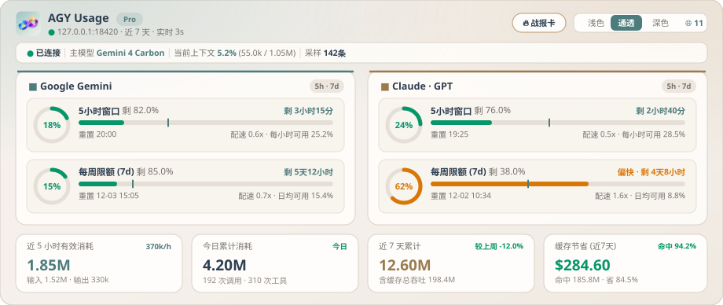
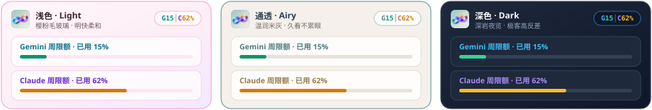
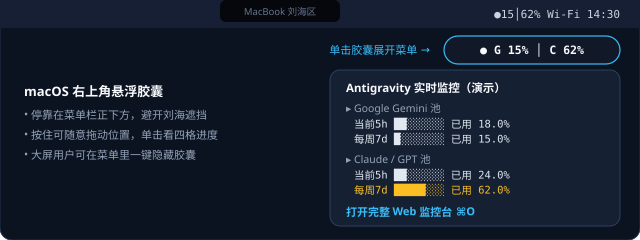
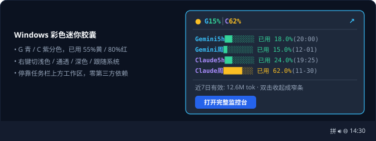
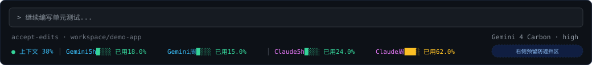
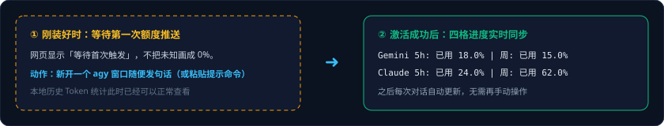

#  Antigravity 额度与用量监控台 — 一眼看清 Gemini / Claude 用掉多少、何时重置

[](./LICENSE)  -8b5cf6.svg) 

> 🌐 **简体中文** · [繁體中文](./README_ZH-TW.md) · [English](./README_EN.md) *(网页监控台内置 11 国语言自动识别与一键切换，支持「浅色 · 通透 · 深色」三套主题)*

用 Antigravity 写代码时，**5 小时限额**和**每周限额**常常不知不觉就快见底了，等突然卡住才发现已经晚了。  
这个小工具在**你自己电脑本地**读取使用记录，帮你把额度做成直观的进度条和倒计时——**不需要输入任何账号密码，也不会往外网上传你的对话内容**（界面里的费用数字仅按公开单价做参考估算，不代表官方实际账单）。





- **网页监控台**：左右并排看清 Gemini 和 Claude/GPT 两套池子的「已用 %」和恢复时间。
- **桌面小胶囊**：Mac 停在右上角（不怕刘海挡住），Windows 停在右下角，写代码时余光就能瞄一眼。
- **终端底部进度条**：不遮挡对话，跟着你的每次提问自动刷新。

---

## 开始前准备

1. 你的电脑上已经安装并在用 **Google Antigravity**。
2. 电脑里有 **Python 3.9 或更新版本**（Mac 一般自带或装过开发工具就有；Windows 安装 Python 时记得勾选 `Add Python to PATH`）。
3. **可选**：Mac 右上角毛玻璃小胶囊需要系统自带的命令行编译工具（`xcode-select --install`）；如果暂时没装也不影响，网页监控台照样能直接用。

---

## 三步用起来

### 第 1 步：安装启动

**如果你用 Mac：**
- **方法一（推荐，打开“终端”粘贴回车）**：
  ```bash
  curl -fsSL https://raw.githubusercontent.com/qiudai0627/agy-usage/main/install.sh | bash
  ```
- **方法二（不想敲命令）**：去 [Releases 下载压缩包](https://github.com/qiudai0627/agy-usage/releases) 解压，右键点击 **`Start-Mac.command`** 选择「**打开**」。

**如果你用 Windows：**
- **方法一（推荐，打开 PowerShell 粘贴回车）**：
  ```powershell
  irm https://raw.githubusercontent.com/qiudai0627/agy-usage/main/install.ps1 | iex
  ```
- **方法二（不想敲命令）**：下载解压后，直接双击 **`Start-Windows.bat`**。

---

### 第 2 步：装完看屏幕哪里？

安装完成后会自动打开三个地方（你喜欢看哪个就用哪个）：
1. **浏览器网页**：自动打开 `http://127.0.0.1:18420` 完整监控台。
2. **屏幕角落小胶囊**：Mac 看屏幕右上角菜单栏正下方；Windows 看屏幕右下角任务栏上方（按住可拖动位置，点击可展开四格进度）。

| Mac 右上角防刘海小胶囊 | Windows 右下角迷你小胶囊 |
| :---: | :---: |
|  |  |

3. **终端最底下**：多出一条四格彩色额度条（不会重复印一遍模型名字，右边也留好了空位避开提示框）：



---

### 第 3 步：激活额度百分比

**新开一个 Antigravity 窗口随便发一句话**（或者在已经开着的窗口里，把安装结束时提示的那行激活口令粘贴进去发一次），几秒内四个格子的「已用 %」和恢复倒计时就会全部亮起来。



---

## 没显示百分比怎么办？

对照下面三种情况，做一个动作就能解决：

1. **网页 `http://127.0.0.1:18420` 打不开**
   - **原因**：后台看板没启动。
   - **怎么做**：重新双击一次 `Start-Mac.command`（Mac）或 `Start-Windows.bat`（Windows）。
   - **成功标志**：浏览器正常打开监控页面。
2. **网页打开了，但上面提示「等待首次触发」**
   - **原因**：你安装之前就已经开着的旧对话窗口，还没给监控台发过一次额度数据（此时工具绝不会拿假 `0%` 糊弄你）。
   - **怎么做**：关掉旧窗口**重开一个新的 Antigravity 对话发一句话**，或者点网页右上角的复制按钮，把那行口令贴进当前对话回车。
   - **成功标志**：网页顶部变成左右两张带圆环的卡片，显示真实的「已用 %」。
3. **百分比停在很久以前不动了**
   - **原因**：这段时间你没有发起新对话，或者刚刚跨过重置时间点还没发新消息。
   - **怎么做**：在 Antigravity 里正常发一条消息，后端就会刷新最新额度。
   - **成功标志**：网页顶部「同步于…」变成刚刚的时间，「待刷新」变成新的倒计时。

---

## 四个格子怎么读？

- **左边两格是 Google Gemini 池，右边两格是 Claude / GPT 池**：这两套额度是**分开算**的。哪怕右边 Claude 用到了 60%，左边 Gemini 依然有充足额度可以用。
- **每个池子都分「5h 窗口」和「7d 每周」两条线**：
  - **5h 窗口**：防短时间猛刷的短期额度，几小时就会自动回满。
  - **7d 每周**：一周的总额度，哪一条先到 **100%** 都会触发限额。
- **统一看「已用 %」**：数字越小、绿条越短说明额度越宽裕；超过 55% 变黄提醒，超过 80% 变红告急。

---

## 常见问题（FAQ）

- **问：为什么官方网页里写「已使用 0%」，这里却能看到小数？**  
  答：可能是官方页面按整数四舍五入展示或存在刷新时间差（比如“1 小时前更新”）。本工具直接展示本机收到的原始比例，方便尽早看出趋势，但不替代官方最终结算口径。
- **问：把浏览器网页关掉，后台还会继续记录吗？**  
  答：会的。只要你在用 Antigravity 对话，底栏每次刷新都会自动把最新额度记在本机缓存里，随时再打开网页就能看到完整曲线。
- **问：我的数据存在哪里？安全吗？**  
  答：全部保存在你自己电脑的本地缓存目录（Mac 在 `~/.cache/agy-usage/`，Windows 在 `%LOCALAPPDATA%\agy-usage\`），不联网上传。
- **问：遇到问题或有建议怎么反馈？**  
  答：直接在本仓库提交 [GitHub Issue](https://github.com/qiudai0627/agy-usage/issues) 即可。

---

## 怎么卸载？

不想用了可以一键还原配置并停掉后台：

- **Mac / Linux**：在项目目录运行 `./uninstall.sh`（如果是一行命令安装的，运行 `~/.local/share/agy-usage/uninstall.sh`）。
- **Windows**：在项目目录打开 PowerShell 运行：
  ```powershell
  powershell -ExecutionPolicy Bypass -File .\uninstall.ps1
  ```
  *(如果是远程一行命令安装的，脚本位于 `%LOCALAPPDATA%\agy-usage\app\uninstall.ps1`，请**先运行它完成卸载**，最后如果不想保留历史曲线，再手动删除 `%LOCALAPPDATA%\agy-usage` 或 Mac 的 `~/.cache/agy-usage` 文件夹。)*

---

<details>
<summary><b>附录：命令行速查、健康清理与开发者说明（点击展开）</b></summary>

### 常用终端命令
```bash
agy-usage                    # 终端打印完整报告（支持 -w 5h/today/24h/week/7d/all）
agy-usage watch              # 终端每 2 秒自动刷新面板
agy-usage daemon status      # 查看后台网页服务状态（支持 start / stop / restart）
agy-usage notify on          # 开启 80%/95% 额度提醒与恢复桌面通知（默认 off，随时可关）
agy-usage clean              # 压缩去重历史快照、轮转日志并清理多余配置备份
agy-usage doctor             # 先只读体检链路与存储健康（加 --fix 可一键修复配置与孤儿临时文件）
agy-usage json               # 导出结构化 JSON 数据
```

### 技术说明与打包自检
- 本项目使用 Python 3.9+ 标准库与 macOS 原生 Swift 编写，零第三方包依赖，前端无 Node 构建链。
- 本地开发验证与零隐私泄露打包：
  ```bash
  ./verify.sh
  ./scripts/package-release.sh
  ```
- 开源许可：[MIT License](./LICENSE)

</details>
