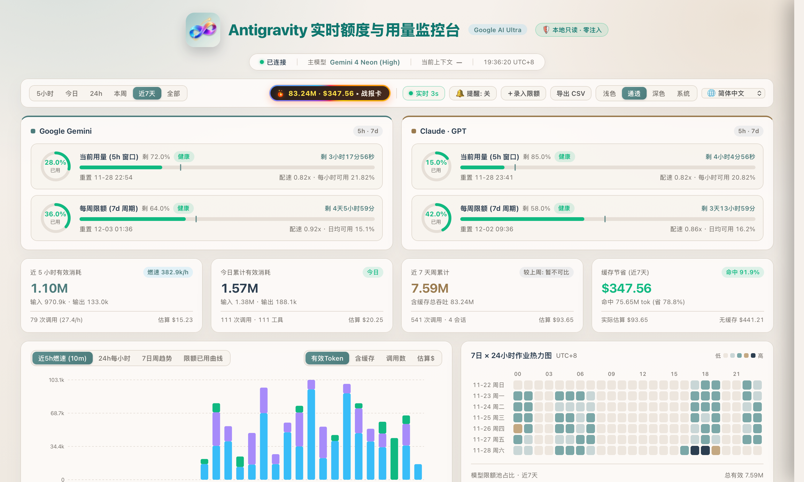

<div align="center">
  
  <h1>Antigravity 实时额度与用量监控台</h1>
  <p><b>Antigravity 本地只读额度与用量监控台 · 官方原生插件</b></p>

  <p>
    <a href="https://github.com/qiudai0627/agy-usage/releases"></a>
    <a href="https://github.com/qiudai0627/agy-usage/actions"></a>
    <a href="./LICENSE"></a>
    
    
    
  </p>

  <p>
    <b>简体中文</b> · <a href="./README_ZH-TW.md">繁體中文</a> · <a href="./README_EN.md">English</a>
  </p>
</div>

<p align="center">
  
</p>

<p align="center">
  
</p>

## 核心特性

- **双池四桶实时配速**：独立追踪 **Google Gemini**（`5h` + `7d`）与 **Claude · GPT**（`5h` + `7d`）额度已用百分比、秒级重置倒计时、周期配速比与耗尽预测。
- **全形态桌面与终端协同**：提供本地 Web 监控台（`127.0.0.1:18420`）、macOS 原生防刘海毛玻璃胶囊与菜单栏应用、Windows 桌面迷你悬浮窗及自适应终端底栏。
- **深度 Token 与缓存洞察**：内置近 5h（10m 粒度）燃速图、24h / 7d 堆叠趋势、7×24 活跃热力图、自然周同进度环比，以及单会话逐轮上下文增长抽屉与 CSV 导出。
- **脱敏战报卡与智能提醒**：内置 2× 高清脱敏战报分享卡生成器（`浅色 · 通透 · 深色`），支持去重式 80% / 95% 阈值预警与额度回血桌面通知。
- **官方原生 AGY 插件与三层清晰边界**：内置自包含 `plugins/agy-usage/`（`/agy-usage` Skill + 4 工具零依赖 `stdio` MCP Server），零 CDP 注入、不改客户端磁盘文件、安装无默认副作用。
- **零第三方运行时依赖**：基于 Python 3.9+ 标准库（`O(1)` 单会话增量分片索引 + 跨平台单实例锁与实例身份握手）与原生 Swift / `tkinter`，Web 界面内置 11 国语言一键切换。

## 三层数据与安全边界（透明披露）

| 层级 | 范围与行为说明 |
| :--- | :--- |
| **1. 客户端数据层（纯只读、零侵入）** | 仅只读解析本地 Antigravity 日志与状态文件；无 CDP 注入、无 `--remote-debugging-port`、不修改客户端磁盘文件、不读取账号/OAuth 凭据。 |
| **2. 本工具自有本地状态层** | 自有缓存、偏好与日志保存在 `~/.cache/agy-usage/`（Windows 为 `%LOCALAPPDATA%\agy-usage\`）；官方原生插件安装零默认副作用，CLI 安装脚本仅在用户执行或显式确认时写入可逆的终端底栏配置。 |
| **3. MCP 对话上下文层** | 启用原生插件 MCP 时，脱敏聚合指标（不含对话标题、正文、preview、本地路径与原始会话 ID）会返回并进入宿主模型对话上下文。 |

## 快速安装

环境要求：已安装 **Google Antigravity** 与 **Python 3.9+**（macOS 原生悬浮胶囊可选装 `xcode-select --install`）。

### 方式一：官方原生 AGY 插件（零默认副作用，含 `/agy-usage` 与 4 只读 MCP 工具）

```bash
agy plugin install https://github.com/qiudai0627/agy-usage/tree/main/plugins/agy-usage
```

### 方式二：完整桌面与终端监控套件（macOS / Linux）

```bash
curl -fsSL https://raw.githubusercontent.com/qiudai0627/agy-usage/main/install.sh | bash
```

也可通过 Homebrew 安装 CLI：

```bash
brew install qiudai0627/tap/agy-usage
```

### Windows (PowerShell)

```powershell
irm https://raw.githubusercontent.com/qiudai0627/agy-usage/main/install.ps1 | iex
```

> **免命令行方式**：前往 [Releases](https://github.com/qiudai0627/agy-usage/releases) 下载压缩包解压，macOS 右键打开 `Start-Mac.command`，Windows 双击 `Start-Windows.bat`。安装后新开一个 Antigravity 会话（或将监控台顶栏提示的激活口令粘贴至当前会话）即可同步实时额度。

## 多端形态预览

| macOS 防刘海毛玻璃胶囊 & 菜单栏 | Windows 任务栏迷你悬浮胶囊 |
| :---: | :---: |
|  |  |

<p align="center">
  
</p>

## 命令行速查

| 命令 | 说明 |
| :--- | :--- |
| `agy-usage [-w 5h\|today\|24h\|week\|7d\|all]` | 在终端输出多窗口额度与 Token 统计报告 |
| `agy-usage watch [-i 2]` | 终端实时自动刷新监控面板 |
| `agy-usage daemon start\|stop\|restart\|status` | 管理后台常驻 Web 监控台（默认 `127.0.0.1:18420`） |
| `agy-usage notify on\|off\|status` | 开启或关闭 80% / 95% 额度预警与回血桌面通知 |
| `agy-usage clean [--keep-days 30]` | 压缩去重历史快照、轮转日志并清理旧备份 |
| `agy-usage doctor [--fix]` | 只读体检采集链路与缓存健康，`--fix` 一键自修复 |
| `agy-usage record-quota <bucket> <rem_pct>` | 手动校准指定额度池剩余百分比 |
| `agy-usage json` | 输出结构化 JSON 统计数据 |

<details>
<summary><b>项目架构与模块目录</b></summary>

```text
agy-usage/
├── src/
│   ├── cli.py             # CLI 入口、配置管理与子命令路由
│   ├── server.py          # 本地回环 HTTP 服务（CSRF / DNS Rebinding 防护）与守护进程
│   ├── tui.py             # ANSI 终端分析报告与 watch 实时面板
│   ├── statusline.py      # 官方 statusLine 实时额度采集与多窗口防回跳状态栏
│   ├── storage.py         # 跨平台文件锁、原子写入、时区与模型参考单价
│   ├── transcripts.py     # 本地 transcript.jsonl 解析与 O(1) 会话增量分片缓存
│   ├── quota.py           # 四桶额度配速、耗尽预测与快照归档压缩
│   ├── analytics.py       # 多时间窗聚合、7x24 热力图、自然周同进度环比与 CSV 导出
│   ├── notifications.py   # 去重式 80% / 95% 预警与回血桌面通知
│   ├── maintenance.py     # 日志保 inode 轮转、缓存瘦身与 doctor 健康诊断
│   ├── i18n.py            # 多语言资源加载器
│   ├── locales/           # 11 国语言独立 JSON 词典 (zh-CN, zh-TW, en, ja, ko, ...)
│   ├── web_ui.py          # 零 CDN 前端静态资源装配器
│   └── web/               # 独立前端模块 (index.html, styles.css, charts.js, app.js, share_card.js)
├── macos/                 # macOS 原生 Swift 菜单栏与防刘海毛玻璃悬浮胶囊
├── windows/               # Windows tkinter 无边框桌面迷你悬浮窗
├── scripts/               # 隐私零泄露门禁扫描与跨平台发布打包脚本
└── tests/                 # 全隔离沙箱单元与多进程锁并发回归测试套件
```

- **本地缓存目录**：macOS / Linux 位于 `~/.cache/agy-usage/`，Windows 位于 `%LOCALAPPDATA%\agy-usage\`。
- **开发自检与打包**：
  ```bash
  ./verify.sh
  ./scripts/package-release.sh
  ```

</details>

<details>
<summary><b>常见问题与一键卸载</b></summary>

- **监控台显示「待触发推送」**：安装前已打开的旧窗口尚未触发首次推送；新开一个 Antigravity 会话发送任意消息，或复制监控台顶栏口令在当前会话执行一次即可激活（未收到真实数据前绝不伪造 `0%`）。
- **费用估算口径**：界面中的美元金额与缓存节省按公开 API 参考单价估算，仅用于衡量吞吐量级与缓存收益，不代表官方账单。
- **一键卸载**：
  - **macOS / Linux**：运行 `./uninstall.sh`（远程安装路径为 `~/.local/share/agy-usage/uninstall.sh`）。
  - **Windows**：运行 `powershell -ExecutionPolicy Bypass -File .\uninstall.ps1`（远程安装路径为 `%LOCALAPPDATA%\agy-usage\app\uninstall.ps1`）。

</details>

## License

[MIT License](./LICENSE)
