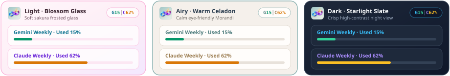
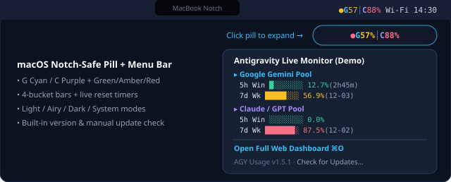
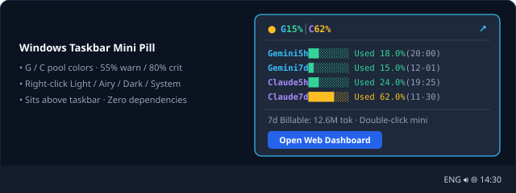
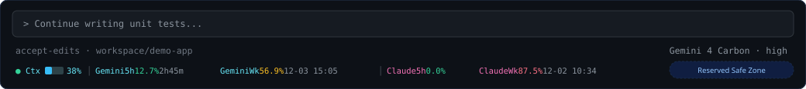

<div align="center">
  
  <h1>Antigravity Quota &amp; Usage Monitor</h1>
  <p><b>AGY Usage · Real-Time Dual-Pool Quota Pacing, Token Analytics &amp; Desktop Widgets</b></p>

  <p>
    <a href="https://github.com/qiudai0627/agy-usage/releases"></a>
    <a href="https://github.com/qiudai0627/agy-usage/actions"></a>
    <a href="./LICENSE"></a>
    
    
    
  </p>

  <p>
    <a href="./README.md">简体中文</a> · <a href="./README_ZH-TW.md">繁體中文</a> · <b>English</b>
  </p>
</div>

<p align="center">
  
</p>

<p align="center">
  
</p>

## Highlights

- **Dual-Pool Quota Telemetry**: Independently tracks **Google Gemini** (`5h` + `7d`) and **Claude · GPT** (`5h` + `7d`) usage percentages, live reset countdowns, cycle pacing ratios, and exhaustion forecasts.
- **Multi-Surface Experience**: Ships a local Web Dashboard (`127.0.0.1:18420`), a native macOS Swift notch-safe glass pill & menu bar app, a Windows taskbar mini-widget, and an adaptive terminal bar.
- **Deep Token & Cache Analytics**: 5h (10-minute) burst chart, 24h / 7d stacked model trends, 7×24 activity heatmap, same-progress week-over-week comparison, turn-by-turn session context inspector, and CSV export.
- **Share Card & Smart Alerts**: Built-in 2× Retina privacy-redacted Share Card generator (`Light · Airy · Dark`) plus deduplicated 80% / 95% threshold & quota-recovery desktop notifications.
- **100% Local & Private**: Zero login, zero cloud sync, zero outbound requests; loopback-only HTTP server hardened with `Host`, `Origin`, and `Sec-Fetch-Site` verification.
- **Zero Runtime Dependencies**: Pure Python 3.9+ standard library (`O(1)` incremental per-session shard cache) + native Swift / `tkinter`, with 11 built-in UI languages.

## Quick Start

Prerequisites: **Google Antigravity** and **Python 3.9+** (optional `xcode-select --install` on macOS to compile the native Swift menu bar pill).

### macOS / Linux

```bash
curl -fsSL https://raw.githubusercontent.com/qiudai0627/agy-usage/main/install.sh | bash
```

Or install the CLI via Homebrew:

```bash
brew install qiudai0627/tap/agy-usage
```

### Windows (PowerShell)

```powershell
irm https://raw.githubusercontent.com/qiudai0627/agy-usage/main/install.ps1 | iex
```

> **GUI Archive Option**: Download the latest archive from [Releases](https://github.com/qiudai0627/agy-usage/releases), extract it, and open `Start-Mac.command` (macOS) or `Start-Windows.bat` (Windows). Open a new Antigravity session (or paste the one-line activation command shown in the dashboard header into an open session) to begin live quota streaming.

## Desktop & Terminal Surfaces

| macOS Notch-Safe Pill & Menu Bar | Windows Taskbar Mini-Widget |
| :---: | :---: |
|  |  |

<p align="center">
  
</p>

## CLI Reference

| Command | Description |
| :--- | :--- |
| `agy-usage [-w 5h\|today\|24h\|week\|7d\|all]` | Print terminal quota & token analytics report |
| `agy-usage watch [-i 2]` | Live auto-refreshing terminal dashboard |
| `agy-usage daemon start\|stop\|restart\|status` | Manage background Web Dashboard (`127.0.0.1:18420`) |
| `agy-usage notify on\|off\|status` | Toggle 80% / 95% quota alerts & recovery notifications |
| `agy-usage clean [--keep-days 30]` | Compact snapshots, rotate logs, and prune old backups |
| `agy-usage doctor [--fix]` | Read-only pipeline & cache diagnostics (`--fix` auto-repairs) |
| `agy-usage record-quota <bucket> <rem_pct>` | Manually calibrate remaining percentage for a bucket |
| `agy-usage json` | Export structured JSON analytics payload |

<details>
<summary><b>Architecture &amp; Module Layout</b></summary>

```text
agy-usage/
├── src/
│   ├── cli.py             # CLI entry point, configuration & subcommand router
│   ├── server.py          # Loopback HTTP server (CSRF / DNS-rebinding hardened) & daemon manager
│   ├── tui.py             # ANSI terminal analytics report & live watch loop
│   ├── statusline.py      # Official statusLine quota collector & anti-rollback terminal bar
│   ├── storage.py         # Cross-platform file locks, atomic writes, timezones & pricing rates
│   ├── transcripts.py     # Local transcript.jsonl parser & O(1) per-session shard cache
│   ├── quota.py           # 4-bucket quota pacing, burn projections & snapshot compaction
│   ├── analytics.py       # Multi-window aggregation, 7x24 heatmap, WoW comparison & CSV export
│   ├── notifications.py   # Deduplicated 80% / 95% alerts & confirmed-recovery OS notifications
│   ├── maintenance.py     # Inode-preserving log rotation, cache pruning & doctor diagnostics
│   ├── i18n.py            # Multilingual catalog loader
│   ├── locales/           # 11 standalone JSON locale dictionaries (en, zh-CN, zh-TW, ja, ko, ...)
│   ├── web_ui.py          # Zero-CDN frontend static asset assembler
│   └── web/               # Modular frontend assets (index.html, styles.css, charts.js, app.js, share_card.js)
├── macos/                 # Native Swift menu bar & notch-safe floating glass pill
├── windows/               # Borderless Windows tkinter mini floating widget
├── scripts/               # Zero-PII gate scanner & release archive packager
└── tests/                 # Isolated sandbox unit & multiprocess concurrency test suite
```

- **Local Cache Directory**: `~/.cache/agy-usage/` on macOS / Linux, `%LOCALAPPDATA%\agy-usage\` on Windows.
- **Verification & Release Packaging**:
  ```bash
  ./verify.sh
  ./scripts/package-release.sh
  ```

</details>

<details>
<summary><b>FAQ &amp; Uninstall</b></summary>

- **"Awaiting first push" state**: Sessions opened before installation have not emitted a quota event yet. Open a new Antigravity session and send any message, or run the one-line activation command shown in the dashboard header (the monitor never fabricates fake `0%` numbers before receiving official data).
- **Cost estimates**: Dollar figures and cache savings are calculated from public API list prices for throughput reference only and do not represent official billing.
- **1-Command Uninstall**:
  - **macOS / Linux**: Run `./uninstall.sh` (or `~/.local/share/agy-usage/uninstall.sh` for remote installs).
  - **Windows**: Run `powershell -ExecutionPolicy Bypass -File .\uninstall.ps1` (or `%LOCALAPPDATA%\agy-usage\app\uninstall.ps1`).

</details>

## License

[MIT License](./LICENSE)
