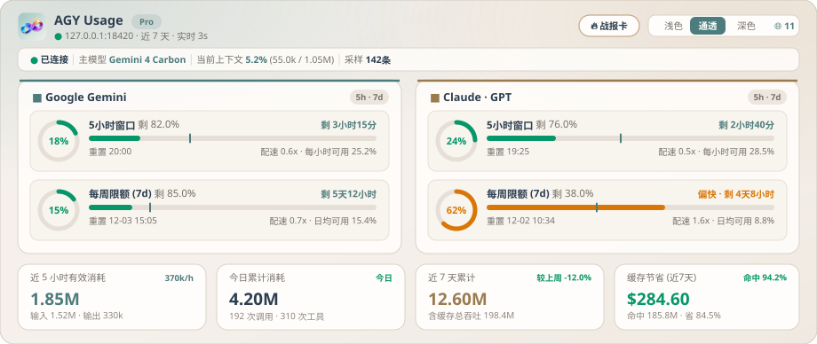
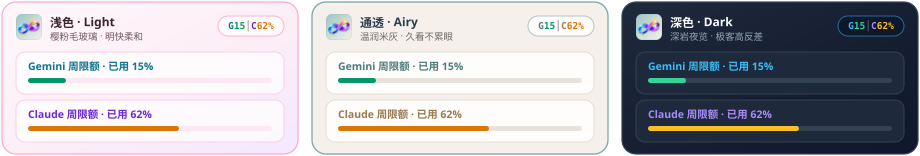
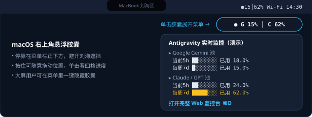
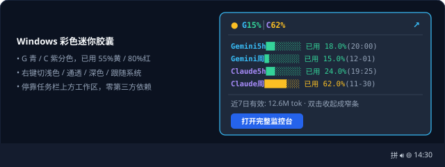
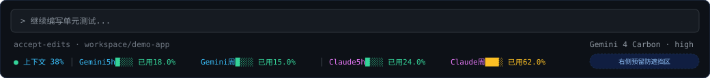
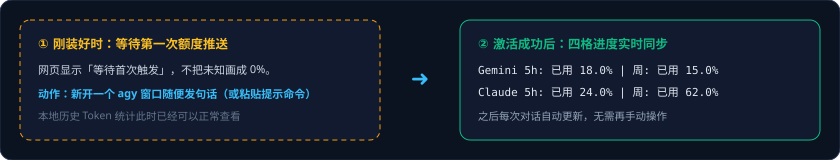

#  Antigravity Quota & Usage Monitor — Live Gemini & Claude Limit, Reset Timer & Token Tracker

[](./LICENSE)  -8b5cf6.svg) 

> 🌐 [简体中文](./README.md) · [繁體中文](./README_ZH-TW.md) · **English** *(Web Dashboard auto-detects and switches across **11 languages** with built-in **Light · Airy · Dark** color themes)*

When coding in Google Antigravity, your **5-hour window** and **weekly quota** can quietly run low—and by the time you hit a rate limit mid-task, it's already disruptive.  
This lightweight utility reads usage records **strictly on your own computer** and turns them into clear progress bars and reset countdowns. **No account passwords required, zero cloud uploads, zero third-party packages** (cost figures shown in the UI are reference estimates based on public API list prices, not official billing).





- **Local Web Dashboard**: Side-by-side rings & pace bars for both **Gemini** and **Claude/GPT** pools, with Light / Airy / Dark themes, 11-language instant switching, and a **📸 1-click privacy-safe Share Card**.
- **Floating Desktop Pill**: Sits cleanly below the top-right menu bar on Mac (never hidden behind the MacBook camera notch) or above the bottom-right taskbar on Windows.
- **Terminal Bottom Bar**: Stays compact under your chat without repeating the model name or colliding with right-corner update popups.

---

## Before You Start

1. You already have **Google Antigravity** installed and working on your computer.
2. You have **Python 3.9 or newer** installed (built into macOS Command Line Tools; on Windows, check `Add Python to PATH` during installation).
3. **Optional (macOS)**: Building the native frosted-glass menu bar pill uses Apple's Command Line Tools (`xcode-select --install`). Even without it, the Web Dashboard works right away.

---

## Up and Running in 3 Steps

### Step 1: Install & Launch

**On Mac:**
- **Option A (Recommended — paste into Terminal and press Enter)**:
  ```bash
  curl -fsSL https://raw.githubusercontent.com/qiudai0627/agy-usage/main/install.sh | bash
  ```
- **Option B (Homebrew CLI)**:
  ```bash
  brew install qiudai0627/tap/agy-usage
  ```
- **Option C (No command line)**: Download the zip from [Releases](https://github.com/qiudai0627/agy-usage/releases), unzip it, right-click **`Start-Mac.command`**, and click **Open**.

**On Windows:**
- **Option A (Recommended — paste into PowerShell and press Enter)**:
  ```powershell
  irm https://raw.githubusercontent.com/qiudai0627/agy-usage/main/install.ps1 | iex
  ```
- **Option B (No command line)**: Download and unzip from Releases, then double-click **`Start-Windows.bat`**.

---

### Step 2: Where to Look on Your Screen

Once installed, three views are ready (use whichever you prefer):
1. **Browser Dashboard**: Opens automatically at `http://127.0.0.1:18420` (auto-detects your browser language; switch anytime among 11 languages via the top-right `🌐` menu).
2. **Corner Desktop Pill**: Top-right on Mac, bottom-right on Windows (drag to reposition; click or double-click to expand all 4 quota bars, switch appearance, or change language).

| macOS Notch-Safe Floating Pill | Windows Taskbar Mini Pill |
| :---: | :---: |
|  |  |

3. **Bottom of Antigravity Terminal**: A clean 4-bucket color bar showing `Used %` for every pool:



---

### Step 3: Activate Live Quota Percentages

**Open a new Antigravity window and send any message** (or paste the one-line activation command printed at the end of installation into an already-open chat). Within seconds, all 4 quota bars and reset countdowns light up.



---

## No Percentages Showing? (Quick Fixes)

Match what you see below—one action fixes each case:

1. **`http://127.0.0.1:18420` won't open in your browser**
   - **Why**: The local background dashboard isn't running yet.
   - **Fix**: Double-click `Start-Mac.command` (Mac) or `Start-Windows.bat` (Windows) again.
   - **What success looks like**: The monitor page opens in your browser.
2. **The dashboard opens, but says "Waiting for push"**
   - **Why**: Chat windows that were already open *before* installation haven't pushed a quota snapshot yet (the tool never fakes `0%` when data is missing).
   - **Fix**: **Open a brand-new Antigravity chat and send one message**, or click **Copy Command** on the banner and send it in your current chat.
   - **What success looks like**: Two pool cards with circular rings appear at the top showing real `Used %`.
3. **Percentages haven't moved in a long time**
   - **Why**: You haven't sent a message recently, or a reset time just passed without a new request.
   - **Fix**: Send any normal prompt in Antigravity to trigger a fresh update.
   - **What success looks like**: "Synced…" updates to the current time and "Expired" turns into a fresh countdown.

---

## How to Read the 4 Quota Bars

- **Left pair = Google Gemini Pool, Right pair = Claude / GPT Pool**: These two quota pools are **counted separately**. Even if Claude is at 60% used, your Gemini pool still has its own independent quota.
- **Each pool has both a `5h Window` and a `7d Weekly` bar**:
  - **5h Window**: Short-term burst limit that refills after a few hours.
  - **7d Weekly**: Total weekly limit—hitting **100%** on *either* bar triggers rate limiting.
- **Unified on `Used %`**: Lower numbers and shorter green bars mean plenty of quota left; **≥ 55%** turns yellow (fast pace), and **≥ 80%** turns red (low quota).

---

## FAQ

- **Q: Why does the official page show `0%` while this tool shows decimals like `0.4%`?**  
  A: Official pages often round to whole integers or refresh with a delay. This tool displays the raw fraction received locally so you can spot trends early, though official billing always governs.
- **Q: Does it keep recording if I close the browser tab?**  
  A: Yes. Every turn in Antigravity updates your local cache automatically, so your history curve is waiting whenever you reopen the page.
- **Q: Where is my data stored? Is it private?**  
  A: 100% stays on your own disk (`~/.cache/agy-usage/` on macOS/Linux, `%LOCALAPPDATA%\agy-usage\` on Windows). Nothing is uploaded anywhere.
- **Q: Where do I report bugs or suggest features?**  
  A: Open a [GitHub Issue](https://github.com/qiudai0627/agy-usage/issues) directly on this repository.

---

## How to Uninstall

Restore your original settings and stop background services in one command:

- **Mac / Linux**: Run `./uninstall.sh` from the project folder (or `~/.local/share/agy-usage/uninstall.sh` if installed via the one-liner).
- **Windows**: Open PowerShell in the project folder and run:
  ```powershell
  powershell -ExecutionPolicy Bypass -File .\uninstall.ps1
  ```
  *(If installed via the remote one-liner, run `%LOCALAPPDATA%\agy-usage\app\uninstall.ps1` **first**, then optionally delete `%LOCALAPPDATA%\agy-usage` or `~/.cache/agy-usage` if you want to erase historical snapshots.)*

---

<details>
<summary><b>Appendix: CLI Cheatsheet, Health Check & Developer Notes (Click to expand)</b></summary>

### Common CLI Commands
```bash
agy-usage                    # Print terminal report (-w 5h/today/24h/week/7d/all)
agy-usage watch              # Live auto-refreshing terminal dashboard (every 2s)
agy-usage daemon status      # Manage background Web server (start / stop / restart / status)
agy-usage notify on          # Enable 80%/95% quota & reset desktop alerts (off by default)
agy-usage clean              # Compact & deduplicate snapshots, rotate logs, prune old backups
agy-usage doctor             # Read-only pipeline & storage check (add --fix to auto-repair)
agy-usage json               # Export structured JSON analytics
```

### Technical Notes & Release Packaging
- Built exclusively with Python 3.9+ standard library and native macOS Swift (`Cocoa`)—zero `pip` dependencies and zero Node.js build chain.
- Set `AGY_USAGE_LANG=en` (or `zh-TW` / `zh-CN`) to customize the terminal `statusLine` language.
- Run full isolated verification & zero-PII release packaging:
  ```bash
  ./verify.sh
  ./scripts/package-release.sh
  ```
- License: [MIT License](./LICENSE)

</details>
