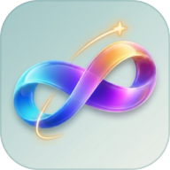
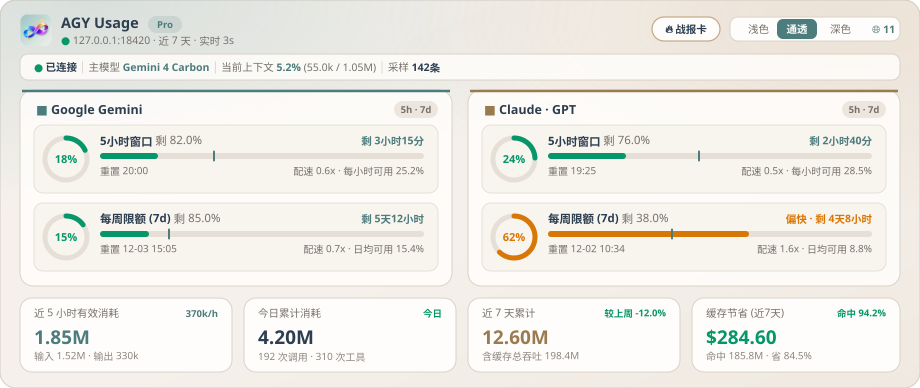
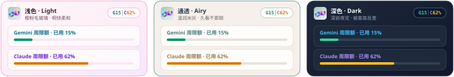
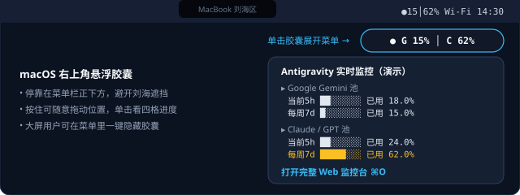
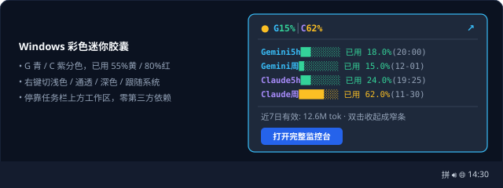
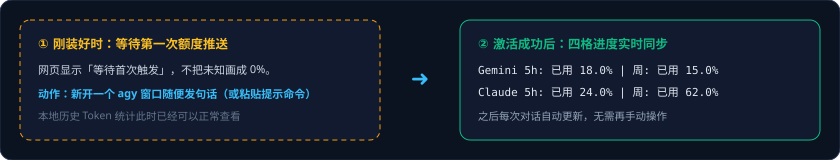

#  Antigravity 額度與用量監控台 — 一眼看清 Gemini / Claude 用掉多少、何時重置

[](./LICENSE)  -8b5cf6.svg) 

> 🌐 [简体中文](./README.md) · **繁體中文** · [English](./README_EN.md) *(網頁監控台內建 11 國語言自動識別與右上角一鍵切換，支援「淺色 · 通透 · 深色」三套主題)*

用 Antigravity 寫程式時，**5 小時額度**和**每週額度**常常不知不覺就快見底了，等突然卡住才發現已經晚了。  
這個小工具在**你自己電腦本機**讀取使用紀錄，幫你把額度做成直觀的進度條與倒數計時——**不需要輸入任何帳號密碼，也不會往外網上傳你的對話內容**（介面裡的費用數字僅按公開單價做參考估算，不代表官方實際帳單）。





- **網頁監控台**：左右並排看清 Gemini 與 Claude/GPT 兩套池子的「已用 %」和恢復時間（支援淺色/通透/深色主題與 11 國語言）。
- **桌面小膠囊**：Mac 停在右上角（不怕瀏海擋住），Windows 停在右下角，寫程式時餘光就能瞄一眼。
- **終端機底部進度條**：不遮擋對話，跟著你的每次提問自動更新。

---

## 開始前準備

1. 你的電腦上已經安裝並在使用 **Google Antigravity**。
2. 電腦裡有 **Python 3.9 或更新版本**（Mac 一般內建或裝過開發工具就有；Windows 安裝 Python 時記得勾選 `Add Python to PATH`）。
3. **選配**：Mac 右上角毛玻璃小膠囊需要系統內建的命令列編譯工具（`xcode-select --install`）；如果暫時沒裝也不影響，網頁監控台照樣能直接用。

---

## 三步用起來

### 第 1 步：安裝啟動

**如果你用 Mac：**
- **方法一（推薦，打開「終端機」貼上並按 Enter）**：
  ```bash
  curl -fsSL https://raw.githubusercontent.com/qiudai0627/agy-usage/main/install.sh | bash
  ```
- **方法二（不想敲指令）**：去 [Releases 下載壓縮包](https://github.com/qiudai0627/agy-usage/releases) 解壓縮，右鍵點擊 **`Start-Mac.command`** 選擇「**打開**」。

**如果你用 Windows：**
- **方法一（推薦，打開 PowerShell 貼上並按 Enter）**：
  ```powershell
  irm https://raw.githubusercontent.com/qiudai0627/agy-usage/main/install.ps1 | iex
  ```
- **方法二（不想敲指令）**：下載解壓縮後，直接雙擊 **`Start-Windows.bat`**。

---

### 第 2 步：裝完看螢幕哪裡？

安裝完成後會自動打開三個地方（你喜歡看哪個就用哪個）：
1. **瀏覽器網頁**：自動開啟 `http://127.0.0.1:18420` 完整監控台（右上角 `🌐` 可隨時切換繁中 / 簡中 / 英文 / 日文等 11 種語言）。
2. **螢幕角落小膠囊**：Mac 看螢幕右上角選單列正下方；Windows 看螢幕右下角工作列上方（按住可拖動位置，點擊可展開四格進度與切換語言/外觀）。

| Mac 右上角防瀏海小膠囊 | Windows 右下角迷你小膠囊 |
| :---: | :---: |
|  |  |

3. **終端機最底下**：多出一條四格彩色額度條（不會重複印一遍模型名字，右邊也留好了空位避開提示框）：


---

### 第 3 步：啟用額度百分比

**新開一個 Antigravity 視窗隨便發一句話**（或者在已經開著的視窗裡，把安裝結束時提示的那行啟用口令貼進去發一次），幾秒內四個格子的「已用 %」和恢復倒數就會全部亮起來。



---

## 沒顯示百分比怎麼辦？

對照下面三種情況，做一個動作就能解決：

1. **網頁 `http://127.0.0.1:18420` 打不開**
   - **原因**：背景看板沒啟動。
   - **怎麼做**：重新雙擊一次 `Start-Mac.command`（Mac）或 `Start-Windows.bat`（Windows）。
   - **成功標誌**：瀏覽器正常開啟監控頁面。
2. **網頁打開了，但上面提示「等待首次觸發」**
   - **原因**：你安裝之前就已經開著的舊對話視窗，還沒給監控台發過一次額度資料（此時工具絕不會拿假 `0%` 糊弄你）。
   - **怎麼做**：關掉舊視窗**重開一個新的 Antigravity 對話發一句話**，或者點網頁右上角的複製按鈕，把那行口令貼進目前對話按 Enter。
   - **成功標誌**：網頁頂部變成左右兩張帶圓環的卡片，顯示真實的「已用 %」。
3. **百分比停在很久以前不動了**
   - **原因**：這段時間你沒有發起新對話，或者剛剛跨過重置時間點還沒發新訊息。
   - **怎麼做**：在 Antigravity 裡正常發一條訊息，後端就會更新最新額度。
   - **成功標誌**：網頁頂部「同步於…」變成剛剛的時間，「待重新整理」變成新的倒數計時。

---

## 四個格子怎麼讀？

- **左邊兩格是 Google Gemini 池，右邊兩格是 Claude / GPT 池**：這兩套額度是**分開算**的。哪怕右邊 Claude 用到了 60%，左邊 Gemini 依然有充足額度可以用。
- **每個池子都分「5h 視窗」和「7d 每週」兩條線**：
  - **5h 視窗**：防短時間猛刷的短期額度，幾小時就會自動回滿。
  - **7d 每週**：一週的總額度，哪一條先到 **100%** 都會觸發限額。
- **統一看「已用 %」**：數字越小、綠條越短說明額度越寬裕；超過 55% 變黃提醒，超過 80% 變紅告急。

---

## 常見問題（FAQ）

- **問：為什麼官方網頁裡寫「已使用 0%」，這裡卻能看到小數？**  
  答：可能是官方頁面按整數四捨五入展示或存在更新時間差（例如「1 小時前更新」）。本工具直接展示本機收到的原始比例，方便儘早看出趨勢，但不替代官方最終結算口徑。
- **問：把瀏覽器網頁關掉，背景還會繼續記錄嗎？**  
  答：會的。只要你在用 Antigravity 對話，底欄每次更新都會自動把最新額度記在本機快取裡，隨時再打開網頁就能看到完整曲線。
- **問：我的資料存在哪裡？安全嗎？**  
  答：全部儲存在你自己電腦的本機快取目錄（Mac 在 `~/.cache/agy-usage/`，Windows 在 `%LOCALAPPDATA%\agy-usage\`），不連網上傳。
- **問：遇到問題或有建議怎麼回饋？**  
  答：直接在本儲存庫提交 [GitHub Issue](https://github.com/qiudai0627/agy-usage/issues) 即可。

---

## 怎麼解除安裝？

不想用了可以一鍵還原設定並停掉背景服務：

- **Mac / Linux**：在專案目錄執行 `./uninstall.sh`（如果是一行指令安裝的，執行 `~/.local/share/agy-usage/uninstall.sh`）。
- **Windows**：在專案目錄打開 PowerShell 執行：
  ```powershell
  powershell -ExecutionPolicy Bypass -File .\uninstall.ps1
  ```
  *(如果是遠端一行指令安裝的，腳本位於 `%LOCALAPPDATA%\agy-usage\app\uninstall.ps1`，請**先執行它完成移除**，最後如果不想保留歷史曲線，再手動刪除 `%LOCALAPPDATA%\agy-usage` 或 Mac 的 `~/.cache/agy-usage` 資料夾。)*

---

<details>
<summary><b>附錄：命令列速查、健康清理與開發者說明（點擊展開）</b></summary>

### 常用終端機指令
```bash
agy-usage                    # 終端機列印完整報告（支援 -w 5h/today/24h/week/7d/all）
agy-usage watch              # 終端機每 2 秒自動更新面板
agy-usage daemon status      # 查看背景網頁服務狀態（支援 start / stop / restart）
agy-usage notify on          # 開啟 80%/95% 額度提醒與恢復桌面通知（預設 off，隨時可關）
agy-usage clean              # 壓縮去重歷史快照、輪轉日誌並清理多餘設定備份
agy-usage doctor             # 先唯讀體檢鏈路與儲存健康（加 --fix 可一鍵修復設定與孤兒暫存檔）
agy-usage json               # 匯出結構化 JSON 資料
```

### 技術說明與打包自檢
- 本專案使用 Python 3.9+ 標準庫與 macOS 原生 Swift 編寫，零第三方套件依賴，前端無 Node 建置鏈。
- 終端機底欄可透過環境變數 `AGY_USAGE_LANG=zh-TW`（或 `en`）切換顯示語言。
- 本機開發驗證與零隱私洩露打包：
  ```bash
  ./verify.sh
  ./scripts/package-release.sh
  ```
- 開源授權：[MIT License](./LICENSE)

</details>
