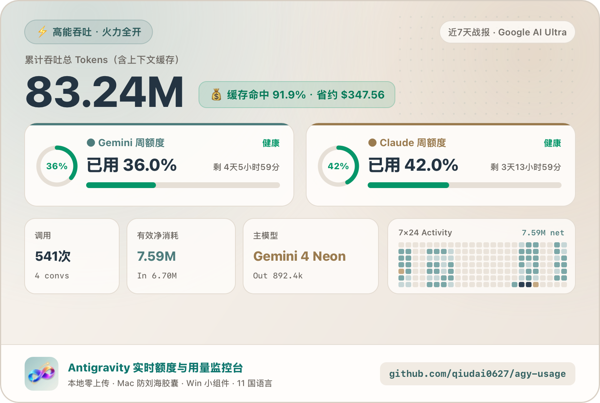
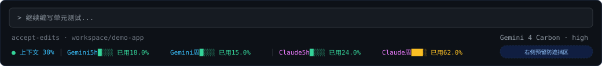

<div align="center">
  
  <h1>Antigravity 即時額度與用量監控台</h1>
  <p><b>Antigravity 本地唯讀額度與用量監控台 · 官方原生外掛</b></p>

  <p>
    <a href="https://github.com/qiudai0627/agy-usage/releases"></a>
    <a href="https://github.com/qiudai0627/agy-usage/actions"></a>
    <a href="./LICENSE"></a>
    
    
    
  </p>

  <p>
    <a href="./README.md">简体中文</a> · <b>繁體中文</b> · <a href="./README_EN.md">English</a>
  </p>
</div>

<p align="center">
  
</p>

<p align="center">
  
</p>

## 核心特性

- **雙池四桶即時配速**：獨立追蹤 **Google Gemini**（`5h` + `7d`）與 **Claude · GPT**（`5h` + `7d`）額度已用百分比、秒級重置倒數、週期配速比與耗盡預測。
- **全形態桌面與終端協同**：提供本地 Web 監控台（`127.0.0.1:18420`）、macOS 原生防瀏海毛玻璃膠囊與選單列應用、Windows 桌面迷你懸浮窗及自適應終端底欄。
- **深度 Token 與快取洞察**：內建近 5h（10m 粒度）燃速圖、24h / 7d 堆疊趨勢、7×24 活躍熱力圖、自然週同進度環比，以及單對話逐輪上下文增長抽屜與 CSV 匯出。
- **去識別戰報卡與智慧提醒**：內建 2× 高清去識別戰報分享卡產生器（`淺色 · 通透 · 深色`），支援去重式 80% / 95% 門檻預警與額度回血桌面通知。
- **官方原生 AGY 外掛與三層清晰邊界**：內建自包含 `plugins/agy-usage/`（`/agy-usage` Skill + 4 工具零依賴 `stdio` MCP Server），零 CDP 注入、不改用戶端磁碟檔案、安裝無預設副作用。
- **零第三方執行期依賴**：基於 Python 3.9+ 標準庫（`O(1)` 單對話增量分片索引 + 跨平台單實例鎖與身份握手）與原生 Swift / `tkinter`，Web 介面內建 11 國語言一鍵切換。

## 三層資料與安全邊界（透明揭露）

| 層級 | 範圍與行為說明 |
| :--- | :--- |
| **1. 用戶端資料層（純唯讀、零侵入）** | 僅唯讀解析本地 Antigravity 日誌與狀態檔；無 CDP 注入、無 `--remote-debugging-port`、不修改用戶端磁碟檔案、不讀取帳號/OAuth 憑證。 |
| **2. 本工具自有本地狀態層** | 自有快取、偏好與日誌保存在 `~/.cache/agy-usage/`（Windows 為 `%LOCALAPPDATA%\agy-usage\`）；官方原生外掛安裝零預設副作用，CLI 安裝腳本僅在使用者執行或明確確認時寫入可逆的終端底欄設定。 |
| **3. MCP 對話上下文層** | 啟用原生外掛 MCP 時，去識別聚合指標（不含對話標題、正文、preview、本地路徑與原始對話 ID）會回傳並進入宿主模型對話上下文。 |

## 快速安裝

環境需求：已安裝 **Google Antigravity** 與 **Python 3.9+**（macOS 原生懸浮膠囊可選裝 `xcode-select --install`）。

### 方式一：官方原生 AGY 外掛（零預設副作用，含 `/agy-usage` 與 4 唯讀 MCP 工具）

```bash
agy plugin install https://github.com/qiudai0627/agy-usage/tree/main/plugins/agy-usage
```

### 方式二：完整桌面與終端監控套件（macOS / Linux）

```bash
curl -fsSL https://raw.githubusercontent.com/qiudai0627/agy-usage/main/install.sh | bash
```

亦可透過 Homebrew 安裝 CLI：

```bash
brew install qiudai0627/tap/agy-usage
```

### Windows (PowerShell)

```powershell
irm https://raw.githubusercontent.com/qiudai0627/agy-usage/main/install.ps1 | iex
```

> **免指令列方式**：前往 [Releases](https://github.com/qiudai0627/agy-usage/releases) 下載壓縮包解壓，macOS 右鍵開啟 `Start-Mac.command`，Windows 雙擊 `Start-Windows.bat`。安裝後新開一個 Antigravity 對話（或將監控台頂欄提示的啟用指令貼入目前對話）即可同步即時額度。

## 多端形態預覽

| macOS 防瀏海毛玻璃膠囊 & 選單列 | Windows 工作列迷你懸浮膠囊 |
| :---: | :---: |
|  |  |

<p align="center">
  
</p>

## 指令列速查

| 指令 | 說明 |
| :--- | :--- |
| `agy-usage [-w 5h\|today\|24h\|week\|7d\|all]` | 在終端機輸出多視窗額度與 Token 統計報告 |
| `agy-usage watch [-i 2]` | 終端機即時自動重新整理監控面板 |
| `agy-usage daemon start\|stop\|restart\|status` | 管理背景常駐 Web 監控台（預設 `127.0.0.1:18420`） |
| `agy-usage notify on\|off\|status` | 開啟或關閉 80% / 95% 額度預警與回血桌面通知 |
| `agy-usage clean [--keep-days 30]` | 壓縮去重歷史快照、輪轉日誌並清理舊備份 |
| `agy-usage doctor [--fix]` | 唯讀健檢採集鏈路與快取健康，`--fix` 一鍵自修復 |
| `agy-usage record-quota <bucket> <rem_pct>` | 手動校準指定額度池剩餘百分比 |
| `agy-usage json` | 輸出結構化 JSON 統計資料 |

<details>
<summary><b>專案架構與模組目錄</b></summary>

```text
agy-usage/
├── src/
│   ├── cli.py             # CLI 入口、設定管理與子指令路由
│   ├── server.py          # 本地回環 HTTP 服務（CSRF / DNS Rebinding 防護）與背景程序
│   ├── tui.py             # ANSI 終端分析報告與 watch 即時面板
│   ├── statusline.py      # 官方 statusLine 即時額度採集與多視窗防回跳狀態列
│   ├── storage.py         # 跨平台檔案鎖、原子寫入、時區與模型參考單價
│   ├── transcripts.py     # 本地 transcript.jsonl 解析與 O(1) 對話增量分片快取
│   ├── quota.py           # 四桶額度配速、耗盡預測與快照歸檔壓縮
│   ├── analytics.py       # 多時間窗聚合、7x24 熱力圖、自然週同進度環比與 CSV 匯出
│   ├── notifications.py   # 去重式 80% / 95% 預警與回血桌面通知
│   ├── maintenance.py     # 日誌保 inode 輪轉、快取瘦身與 doctor 健康診斷
│   ├── i18n.py            # 多語言資源載入器
│   ├── locales/           # 11 國語言獨立 JSON 詞典 (zh-CN, zh-TW, en, ja, ko, ...)
│   ├── web_ui.py          # 零 CDN 前端靜態資源裝配器
│   └── web/               # 獨立前端模組 (index.html, styles.css, charts.js, app.js, share_card.js)
├── macos/                 # macOS 原生 Swift 選單列與防瀏海毛玻璃懸浮膠囊
├── windows/               # Windows tkinter 無邊框桌面迷你懸浮窗
├── scripts/               # 隱私零外洩門禁掃描與跨平台發佈打包腳本
└── tests/                 # 全隔離沙箱單元與多行程鎖並行回歸測試套件
```

- **本地快取目錄**：macOS / Linux 位於 `~/.cache/agy-usage/`，Windows 位於 `%LOCALAPPDATA%\agy-usage\`。
- **開發自檢與打包**：
  ```bash
  ./verify.sh
  ./scripts/package-release.sh
  ```

</details>

<details>
<summary><b>常見問題與一鍵解除安裝</b></summary>

- **監控台顯示「待觸發推送」**：安裝前已開啟的舊視窗尚未觸發首次推送；新開一個 Antigravity 對話傳送任意訊息，或複製監控台頂欄指令在目前對話執行一次即可啟用（未收到真實資料前絕不偽造 `0%`）。
- **費用估算口徑**：介面中的美元金額與快取節省按公開 API 參考單價估算，僅用於衡量吞吐量級與快取收益，不代表官方帳單。
- **一鍵解除安裝**：
  - **macOS / Linux**：執行 `./uninstall.sh`（遠端安裝路徑為 `~/.local/share/agy-usage/uninstall.sh`）。
  - **Windows**：執行 `powershell -ExecutionPolicy Bypass -File .\uninstall.ps1`（遠端安裝路徑為 `%LOCALAPPDATA%\agy-usage\app\uninstall.ps1`）。

</details>

## License

[MIT License](./LICENSE)
